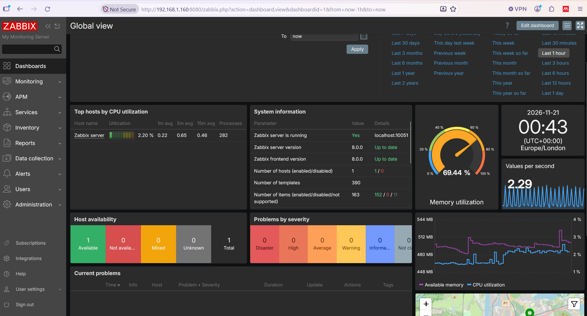
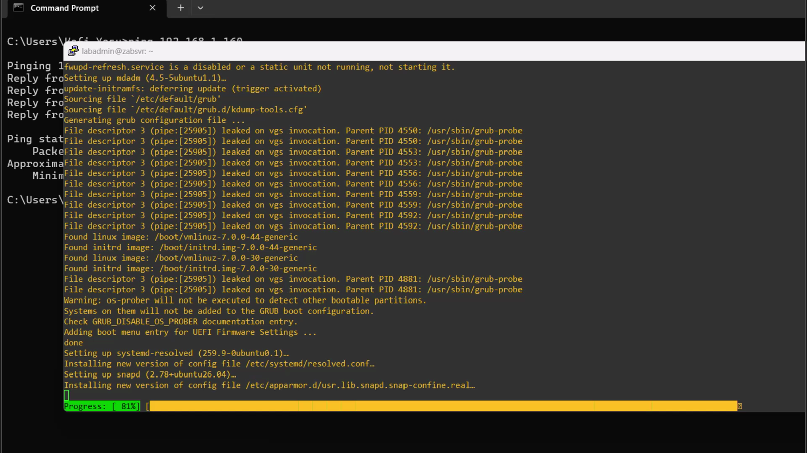
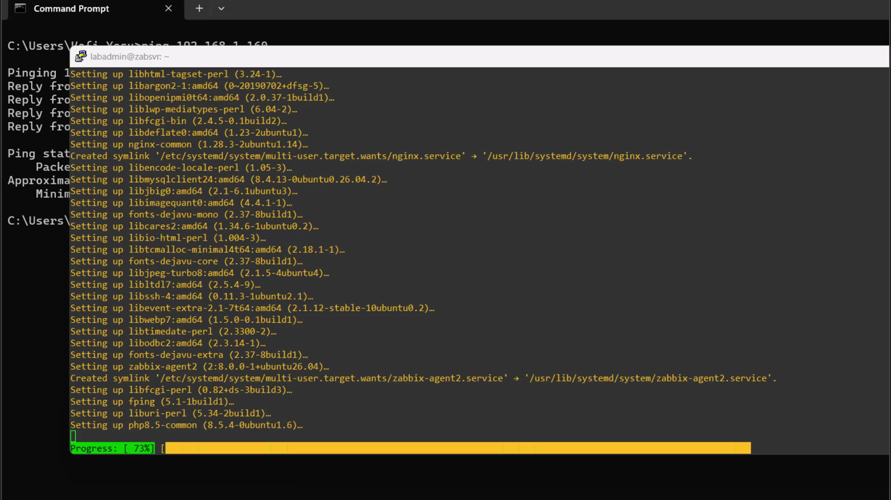
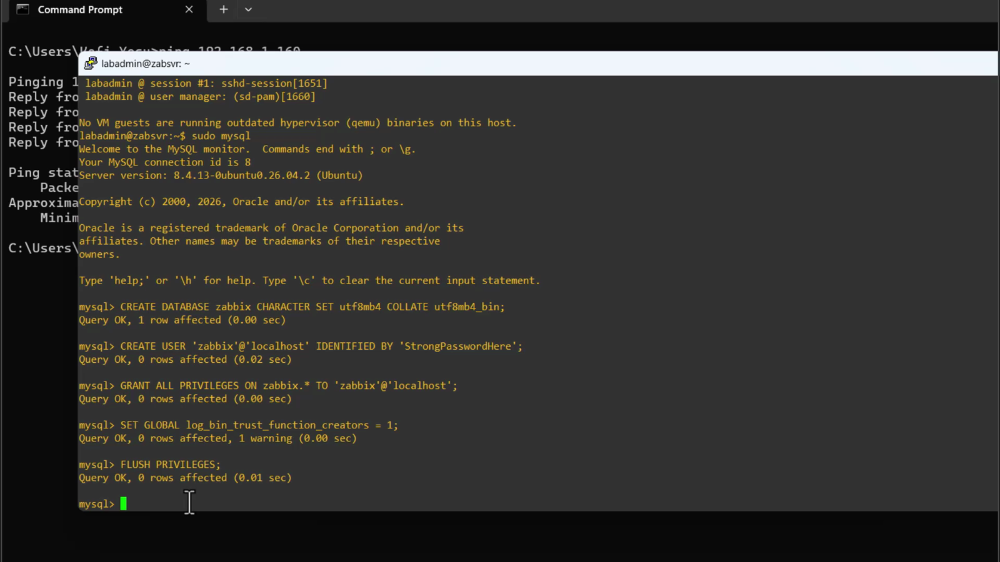
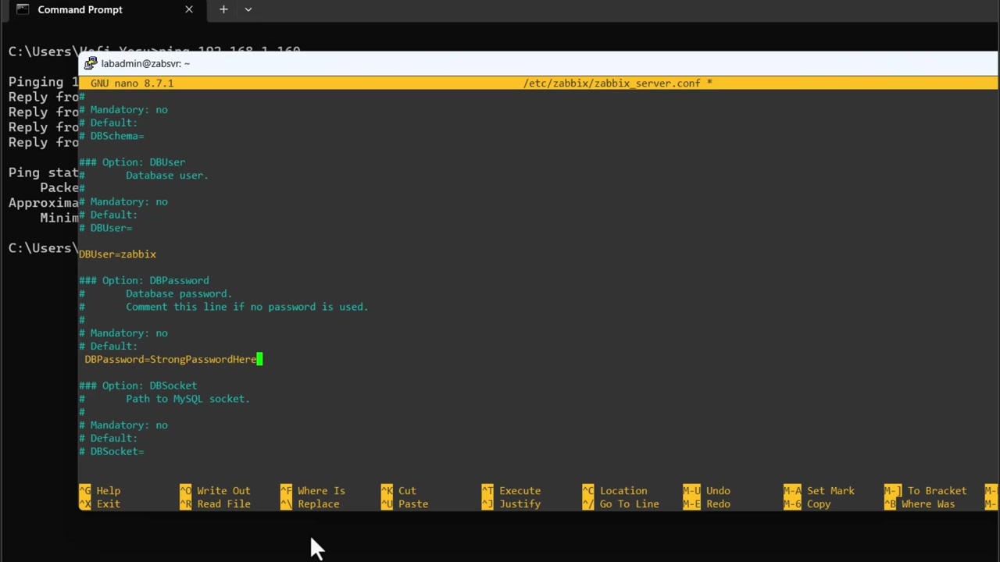
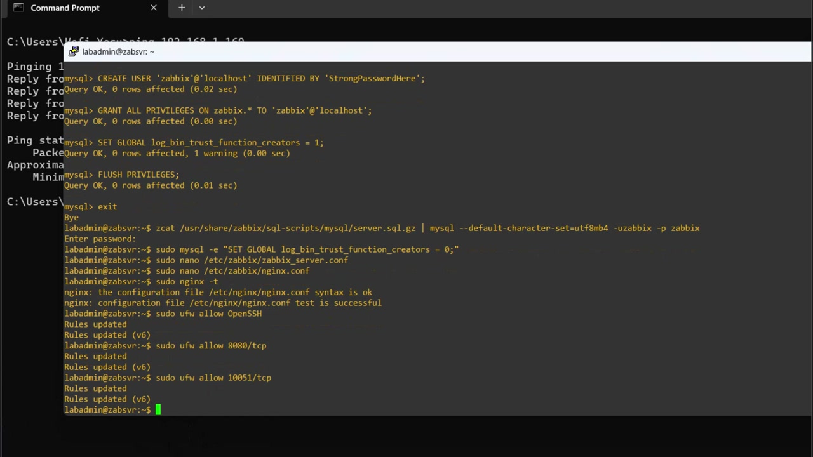
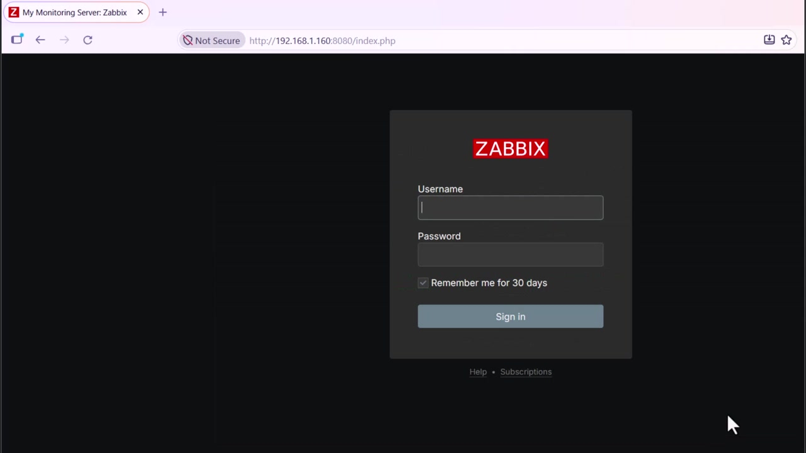

# Zabbix 8 Installation Guide

A step-by-step guide to installing and configuring **Zabbix 8.0** with **MySQL**, **Nginx**, and **PHP-FPM** on Ubuntu.

> **Repository note:** The repository package URL in this guide targets Ubuntu 26.04. Confirm that this matches the Ubuntu release installed on your server before proceeding.

## Video Demonstration

## Video Demonstration

Watch the complete Zabbix 8.0 installation walkthrough:

[](https://youtu.be/2-hw971da6I)


> The video is publicly accessible on YouTube.

## Table of Contents

- [1. Update the System and Add the Zabbix Repository](#1-update-the-system-and-add-the-zabbix-repository)
- [2. Install MySQL, Zabbix, and Required Packages](#2-install-mysql-zabbix-and-required-packages)
- [3. Create and Populate the Zabbix Database](#3-create-and-populate-the-zabbix-database)
- [4. Configure the Zabbix Server](#4-configure-the-zabbix-server)
- [5. Configure Nginx](#5-configure-nginx)
- [6. Configure the Firewall and PHP-FPM](#6-configure-the-firewall-and-php-fpm)
- [7. Start and Enable Zabbix Services](#7-start-and-enable-zabbix-services)
- [8. Complete the Web Setup Wizard](#8-complete-the-web-setup-wizard)
- [Post-installation Checks](#post-installation-checks)

---

## 1. Update the System and Add the Zabbix Repository

### 1.1 Update the package index and install `wget`

```bash
sudo apt update
sudo apt install -y wget
```

### 1.2 Download and install the Zabbix 8.0 repository package

```bash
wget https://repo.zabbix.com/zabbix/8.0/release/ubuntu/pool/main/z/zabbix-release/zabbix-release_latest_8.0+ubuntu26.04_all.deb
sudo dpkg -i zabbix-release_latest_8.0+ubuntu26.04_all.deb
sudo apt update
sudo apt upgrade -y
```

## 2. Install MySQL, Zabbix, and Required Packages

Install MySQL Server, the Zabbix server, frontend, Nginx configuration, SQL scripts, and Zabbix Agent 2.

```bash
sudo apt install -y mysql-server zabbix-server-mysql zabbix-frontend-php zabbix-nginx-conf zabbix-sql-scripts zabbix-agent2
```

## 3. Create and Populate the Zabbix Database

### 3.1 Log in to MySQL

```bash
sudo mysql
```

### 3.2 Create the database and user

Run the following SQL commands. Replace `StrongPasswordHere` with a strong, unique password.

```sql
CREATE DATABASE zabbix CHARACTER SET utf8mb4 COLLATE utf8mb4_bin;
CREATE USER 'zabbix'@'localhost' IDENTIFIED BY 'StrongPasswordHere';
GRANT ALL PRIVILEGES ON zabbix.* TO 'zabbix'@'localhost';
SET GLOBAL log_bin_trust_function_creators = 1;
FLUSH PRIVILEGES;
EXIT;
```

### 3.3 Import the initial Zabbix database schema

Run the following command. Enter the database password when prompted.

```bash
zcat /usr/share/zabbix/sql-scripts/mysql/server.sql.gz | mysql --default-character-set=utf8mb4 -uzabbix -p zabbix
```

### 3.4 Disable the function creator setting

After the schema import is complete, disable `log_bin_trust_function_creators`.

```bash
sudo mysql -e "SET GLOBAL log_bin_trust_function_creators = 0;"
```

## 4. Configure the Zabbix Server

Configure the Zabbix server to authenticate with the MySQL database.

### 4.1 Open the Zabbix server configuration file

```bash
sudo nano /etc/zabbix/zabbix_server.conf
```

### 4.2 Set the database password

Find the following line:

```ini
# DBPassword=
```

Uncomment it and enter the password created in [Step 3](#3-create-and-populate-the-zabbix-database).

```ini
DBPassword=StrongPasswordHere
```

Save and exit:

- `Ctrl + O` to save.
- Press `Enter` to confirm.
- `Ctrl + X` to exit.

## 5. Configure Nginx

### 5.1 Open the Zabbix Nginx configuration file

```bash
sudo nano /etc/zabbix/nginx.conf
```

### 5.2 Configure the listening port and server name

Uncomment the `listen` and `server_name` directives near the top of the file.

Replace `your_server_ip_or_domain` with your server's IP address or fully qualified domain name (FQDN).

```nginx
listen 8080;
server_name your_server_ip_or_domain;
```

> **Port selection:** The example uses port `8080`. If you want to access Zabbix directly on standard HTTP port `80`, change `listen 8080;` to `listen 80;` and remove the default Nginx site to avoid a port conflict:
>
> ```bash
> sudo rm -f /etc/nginx/sites-enabled/default
> ```

Save and exit the editor.

### 5.3 Verify the Nginx configuration

```bash
sudo nginx -t
```

**Expected result:** Nginx reports that the syntax is OK and the configuration test is successful.

## 6. Configure the Firewall and PHP-FPM

### 6.1 Configure UFW

If UFW is enabled, allow SSH, web traffic, and Zabbix server communication.

The following example assumes that you selected port `8080` in Step 5.

```bash
sudo ufw allow OpenSSH
sudo ufw allow 8080/tcp
sudo ufw allow 10051/tcp
sudo ufw enable
sudo ufw reload
```

> If you configured Nginx to listen on port `80`, allow `80/tcp` instead of `8080/tcp`.

### 6.2 Restart and enable PHP-FPM

```bash
sudo systemctl restart php8.5-fpm
sudo systemctl enable php8.5-fpm
```

Verify the PHP-FPM service:

```bash
sudo systemctl status php8.5-fpm
```

**Expected result:** The service status shows `active (running)`.

## 7. Start and Enable Zabbix Services

Enable and start the Zabbix server and Agent 2 services:

```bash
sudo systemctl enable --now zabbix-server zabbix-agent2
```

Test the Nginx configuration and restart Nginx:

```bash
sudo nginx -t && sudo systemctl restart nginx
```

## 8. Complete the Web Setup Wizard

### 8.1 Open the Zabbix frontend

Open a browser and navigate to the appropriate address:

- If using port `80`: `http://<your-server-ip>/`
- If using port `8080`: `http://<your-server-ip>:8080/`

Replace `<your-server-ip>` with your server's IP address.

### 8.2 Complete the setup wizard

Follow the wizard:

1. **Welcome:** Select your preferred language and click **Next step**.
2. **Check of pre-requisites:** Confirm that all PHP checks display **OK** in green, then click **Next step**.
3. **Configure DB connection:**
   - Database type: `MySQL`
   - Database host: `localhost`
   - Database port: `0` (default)
   - Database name: `zabbix`
   - User: `zabbix`
   - Password: Enter the password created in Step 3.
4. **Settings:** Enter a descriptive Zabbix server name (for example, `My Monitoring SVR`) and select your default time zone.
5. **Pre-installation summary:** Review the configuration and click **Next step**, then **Finish**.

## Post-installation Checks

### 1. Log in to Zabbix

Use the default administrator credentials:

| Field | Default value |
|---|---|
| Username | `Admin` |
| Password | `zabbix` |

> **Security:** The username is case-sensitive. Change the default administrator password immediately after your first login.

### 2. Change the administrator password

Navigate to:

**Users → Users → Admin**

Update the default password to a strong, unique password.

### 3. Verify the Zabbix server

Navigate to:

**Monitoring → Hosts**

Confirm that the local Zabbix server is listed and displays a green **ZBX availability** icon.

---


## Installation Screenshots

The following screenshots were extracted from the installation recording and show selected stages of the deployment. They are provided as visual references alongside the written instructions.

### Package installation
## Zabbix Dashboard

The following screenshot shows the successfully
installed Zabbix 8.0 monitoring dashboard.




### Zabbix components installation



### MySQL database configuration



### Service and firewall configuration


### Zabbix server configuration



### Database import and firewall configuration



### Zabbix frontend login



## Completion

The Zabbix 8.0 installation and initial frontend configuration are complete once you can log in, change the default administrator password, and confirm that the local Zabbix server is available.
